# Bytemania

A bytebeat synth firmware for the M-VAVE FM-1, built on [Dinghy](https://github.com/zvenson/dinghy).

<p align="center">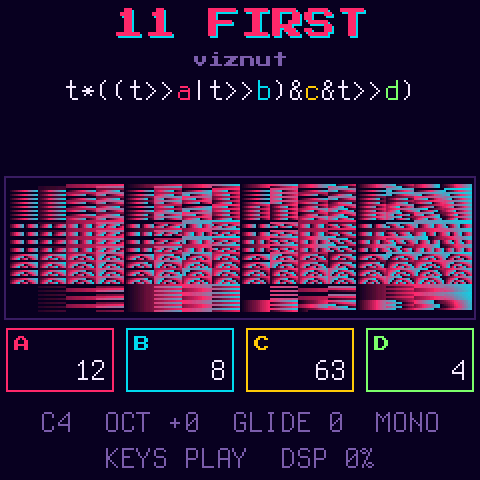</p>

Bytebeat is music from a single line of code: a formula of `t` gives an 8-bit sample for every step of `t`, and
`t` just counts up. Bytemania runs those formulas on the FM-1 and makes them playable. The note you play sets how fast
`t` runs (middle C is 8 kHz, the classic bytebeat rate), and the knobs change the numbers inside the formula while it
plays.

- 30 built-in patches: 8 tuned basic waveforms and 22 classic bytebeats, credited to their authors
- write your own formulas on the device, with a live compiler that tells you what's wrong and where
- a random formula generator that only gives you ones worth hearing
- 64 user slots that keep the whole patch, with names
- 8 variables (`a`-`h`) on the knobs, colour-coded in the formula
- loop and ping-pong over any part of a formula
- four voice modes: mono, a detuned stereo pair, 4-voice poly, and a different formula on each side
- a scope and a raster view of the sound
- USB-MIDI notes, pitch bend, and 12 CC mappings with learn

## Contents

- [Installing](#installing)
- [The main screen](#the-main-screen)
- [Playing](#playing)
- [Views](#views)
- [Knobs and variables](#knobs-and-variables)
- [Loop](#loop)
- [Voice modes](#voice-modes)
- [Built-in patches](#built-in-patches)
- [The editor](#the-editor)
- [Saving and naming](#saving-and-naming)
- [CC mapping](#cc-mapping)
- [Formula language](#formula-language)
- [Building](#building)
- [Credits and licence](#credits-and-licence)

## Installing

Build it (see [Building](#building)) and install it over USB:

```sh
python3 tools/fm1_install.py build/bytemania.fwsc
```

If a build won't start, hold **OCT-** while switching on to get the USB rescue, then install a working build, or go
back to the official firmware from the [FM-1 Firmware Hub](https://thefirmwarehub.com). Installing firmware is at your
own risk.

## The main screen

<p align="center"></p>

From the top:

- the patch: its number and name (`U03` for a user slot), with a `*` if it has unsaved edits
- who wrote it
- the formula, with each variable in its own colour
- the view: the waveform or the raster (see [Views](#views))
- the four knobs, framed in the same colours as their variables in the formula
- the note, octave, glide and voice mode, whether the keys play or pick, and how busy the audio is (DSP %)

## Playing

| | |
| --- | --- |
| Keys | play. Bytemania is mono: the last note held sounds, and letting go returns to the one before |
| OCT- / OCT+ | octave, -2 to +2 |
| SELECT | glide, 0 (off) to 10 |
| PRESETS | the patch: the 30 built-ins, then your saved slots |
| SEL | switch the keys between playing and picking a patch. In pick mode, keys 1-27 pick built-ins 01-27 |
| LFO | tap: the next voice mode. Hold: the knobs set detune, offset and width (see [Voice modes](#voice-modes)) |
| PLAY | in MULTI: switch between the left and right side |
| MASTER | volume |
| USB-MIDI | notes in on any channel, with velocity. Pitch bend is ±2 semitones and ignores glide, so bends are instant |

A new note from silence starts `t` again from 0, so each note begins the same way. A legato note (played while
another is held) keeps `t` running and glides to the new pitch.

The octave, glide, view, key mode, CC mappings and patch are saved and come back after a power-off. Saving waits until
nothing is playing, since writing to flash briefly stops the sound.

## Views

<p align="center">
  
  
</p>

**FX** switches the view:

- **scope**: the last 232 samples, as a waveform
- **raster**: the classic bytebeat picture. Each row is 256 steps of `t`, coloured by the sample (indigo to pink to
  cyan), with the newest row at the bottom. Rhythm and structure show up as patterns. At middle C it covers about the
  last 2 seconds

Both are drawn from the formula itself, so they stay in step with what you hear, including the loop.

## Knobs and variables

<p align="center">
  
  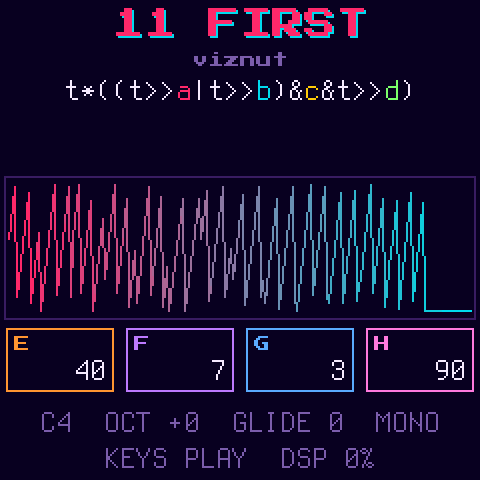
</p>

A formula can use eight variables, `a` to `h`, each 0-255. **KNOB1-4** set `a`-`d`. Hold **HOME** and they set `e`-`h`
instead (the knob boxes change to show which). Turning a knob fast moves 8 at a time.

Each variable has its own colour, used both on its knob and on its letter in the formula, so you can see which knob
changes which part of the sound:

| `a` | `b` | `c` | `d` | `e` | `f` | `g` | `h` |
| --- | --- | --- | --- | --- | --- | --- | --- |
| pink | cyan | yellow | green | orange | violet | blue | rose |

## Loop

<p align="center">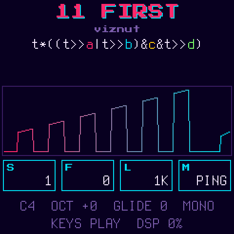</p>

Hold **SEQ** and the knobs set the loop:

| | |
| --- | --- |
| KNOB1 START | where it starts, in raster rows (256 steps of `t`) |
| KNOB2 FINE | plus 0-255 steps, to fine-tune the start |
| KNOB3 LEN | its length: 16 to 65536 steps, in powers of two, so loops stay in time with the formula's rhythm |
| KNOB4 MODE | OFF, LOOP, or PING (forwards then backwards) |

A quick tap on SEQ switches the loop on or off, keeping the last mode. SEQ is lit while a loop is on. A note plays from
`t = 0` until it reaches the start, then loops. Short loops (16-256 steps) turn a formula into a grainy, buzzing tone.

## Voice modes

<p align="center">
  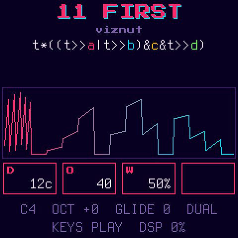
  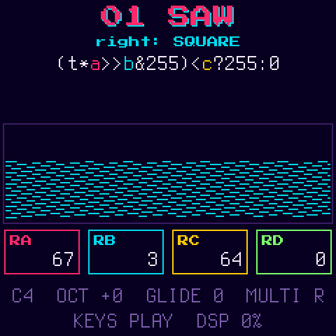
</p>

A tap on **LFO** steps through four voice modes. LFO is lit in any mode but MONO, and the status line shows which.
The mode is part of the patch: saving keeps it, and built-ins start in MONO.

| Mode | |
| --- | --- |
| MONO | one note at a time, with glide |
| DUAL | the formula twice, left and right. Hold **LFO** and KNOB1 detunes the right side (0-100 cents) and KNOB2 starts it further along in `t` (0-255, in steps of 16), for chorus and phasing |
| POLY | up to 4 notes, each running its own `t`. No glide. Each note is half as loud as in MONO, so chords don't clip as much |
| MULTI | a different formula on each side, both playing the note. Each side has its own `a`-`h` |

In DUAL and MULTI, holding **LFO** also puts **WIDTH** on KNOB3: how far apart the two sides are. At 100% each side
has its own channel; lower, each channel mixes in some of the other side, down to 0% where both channels play the
same mix. The FM-1's speaker plays one channel only, so at 100% it plays just one side. The default, 50%, keeps both
sides on the speaker and still sounds wide on headphones. Holding LFO shows only the knobs that do something in the
mode you're in.

In MULTI, the right side starts as a copy of the left. **PLAY** switches which side the screen shows (PLAY is lit for
the right). With the right side shown, **PRESETS** picks its formula from the built-ins and your slots, and the
knobs set its variables, labelled `RA`-`RH`. The editor always edits the left side.

## Built-in patches

<p align="center">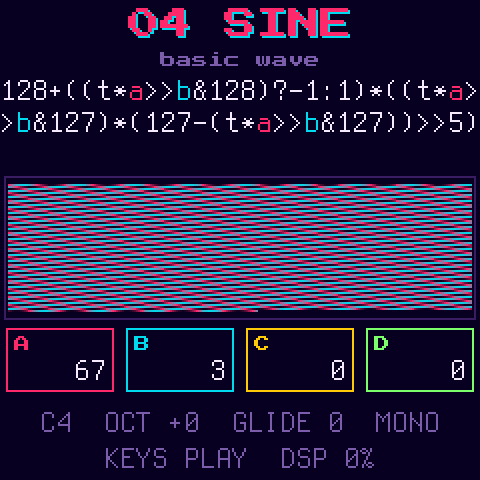</p>

**01-08** are basic waveforms, tuned so middle C plays a C (within a couple of cents). They share a phase of
`t*a>>b`: `a` and `b` set the tuning (turn `a` to detune), and `c` changes the shape where there is one: the square's
width, the PWM's sweep speed, the sync ratio, the XOR's second saw, and the steps' mask.

**09-30** are classic bytebeats from viznut's
[Some deep analysis of one-line music programs](http://countercomplex.blogspot.com/2011/10/some-deep-analysis-of-one-line-music.html)
(2011) and the [bytebeat composer](https://dollchan.net/bytebeat)'s library, with some of their numbers turned into
variables. At their defaults they play exactly the original formula.

| # | Name | By | Formula | Defaults |
| --- | --- | --- | --- | --- |
| 01 | SAW | Bytemania | `t*a>>b` | a=67 b=3 |
| 02 | SQUARE | Bytemania | `(t*a>>b&255)<c?255:0` | a=67 b=3 c=128 |
| 03 | TRIANGLE | Bytemania | `((t*a>>b)^-(t*a>>b>>7&1))*2` | a=67 b=3 |
| 04 | SINE | Bytemania | `128+((t*a>>b&128)?-1:1)*((t*a>>b&127)*(127-(t*a>>b&127))>>5)` | a=67 b=3 |
| 05 | PWM | Bytemania | `(t*a>>b&255)<(t>>c&255)?255:0` | a=67 b=3 c=6 |
| 06 | SYNC | Bytemania | `(t*a>>b&255)*c>>3` | a=67 b=3 c=12 |
| 07 | XOR | Bytemania | `(t*a>>b)^(t*c>>b)` | a=67 b=3 c=101 |
| 08 | STEPS | Bytemania | `t*a>>b&c` | a=67 b=3 c=224 |
| 09 | PLAIN T | viznut | `t*a` | a=1 |
| 10 | MUNCHING | viznut | `t&t>>a` | a=8 |
| 11 | FIRST | viznut | `t*((t>>a\|t>>b)&c&t>>d)` | a=12 b=8 c=63 d=4 |
| 12 | FORTY-TWO | several people | `t*(a&t>>b)` | a=42 b=10 |
| 13 | ROY | Niklas Roy | `t*(t>>a\|t>>b)&c` | a=9 b=13 c=16 |
| 14 | MIIRO | miiro | `t*a&(t>>b)\|t*c&(t*4>>d)` | a=5 b=7 c=3 d=10 |
| 15 | VIZNUT | viznut | `(t*a&t>>b)\|(t*c&t>>d)` | a=5 b=7 c=3 d=10 |
| 16 | STEPHTH | stephth | `t*a&t>>b\|t*c&t>>d\|t*3&t/1024` | a=9 b=4 c=5 d=7 |
| 17 | RRROLA | Rrrola | `t*(0xCA98>>(t>>a&14)&15)\|t>>b` | a=9 b=8 |
| 18 | DROID | droid | `t>>a&1?t>>b:-t>>c` | a=6 b=5 c=4 |
| 19 | SPLIT | unknown | `t*(a+((t>>b)&c))` | a=5 b=11 c=5 |
| 20 | MU6K LEAD | viznut, after Mu6k | `t>>a^t>>b\|t>>c\|t&d` | a=6 b=8 c=12 d=63 |
| 21 | MODEM | krcko | `(t&t>>a)*(t>>b\|t>>c)` | a=12 b=4 c=8 |
| 22 | FRACTAL | Blueberry | `(t>>a^(t>>a)-1^1)%b*t` | a=9 b=13 |
| 23 | RYG TRI | ryg | `(t<<a)^-(t>>b&1)` | a=4 b=4 |
| 24 | JACQUES | Lord Graga | `a*(t>>b\|3*t\|t>>(t>>15))+(t>>8&5)` | a=10 b=7 |
| 25 | LEMMINGS | marmakoide | `t>>a\|t<<b\|t&1023^1981\|t-67>>c` | a=5 b=4 c=4 |
| 26 | SURFER | skurk, raer | `t&4096?t/2*(t^t%255)\|t>>a:t/8\|(t&8192?4*t:t)` | a=5 |
| 27 | CROWD | erlehmann | `2*t^2*t+(t>>a)&t>>b\|t>>4-(1^7&t>>19)\|t>>a` | a=7 b=12 |
| 28 | LATE PARTY | rrrola | `t*(a+(t>>b)%3)&t/3>>7&c` | a=4 b=9 c=224 |
| 29 | C64 GAME | skurk | `t*(t>>(t&4096?t*t>>12:t>>12))\|t<<(t>>a)\|t>>b` | a=8 b=4 |
| 30 | JAUNTY | ryg | `t*(t>>a)*64+(t>>1)*(t>>b)*(t>>c)*48>>((t>>16\|t>>17)&1)` | a=12 b=10 c=11 |

## The editor

<p align="center">
  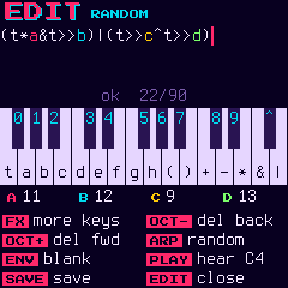
  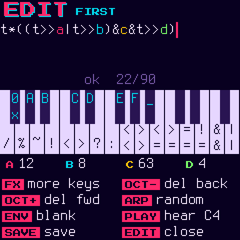
</p>

**EDIT** opens the editor on the formula that's playing. The keys type: the screen shows the keyboard with what each
key types, and holding **FX** switches to a second layer. Every change compiles straight away. If it compiles you hear
it; if not, the line under the formula says what's wrong and where (the spot is underlined in red), and the last
version that compiled keeps playing.

| | |
| --- | --- |
| Keys | type at the cursor |
| FX (held) | the second layer |
| SELECT | move the cursor |
| OCT- / OCT+ | delete before / after the cursor |
| PLAY | a held C4 to listen with, on or off (the keys type here, so they can't play) |
| ARP | a random formula |
| ENV | a blank patch: `t` alone, the variables at 0, no loop, no glide |
| KNOB1-4 | the variables, as on the main screen (HOME and SEQ too) |
| SAVE | save to a user slot (a formula that doesn't compile can't be saved) |
| EDIT | back to the main screen |

What the keys type:

| | White keys | Black keys |
| --- | --- | --- |
| normal | `t a b c d e f g h ( ) + - * & \|` | `0`-`9` `^` |
| FX held | `/ % ~ ! < > ? : << >> <= >= == != && \|\|` | `0x` `A`-`F` and a space |

An edit that isn't saved shows a `*` after the name on the main screen, and keeps playing until you pick another
patch. Built-ins can't be overwritten: saving an edited one saves it to a user slot.

**ARP** makes a random formula from the pieces classic bytebeats are built from (`t` times masked and shifted copies of
itself, joined by `| ^ + &`), with its numbers as the variables `a`-`d` so the knobs reach them. Each one is run
before you hear it, and anything silent, stuck or pure noise is thrown away and another made.

## Saving and naming

<p align="center">
  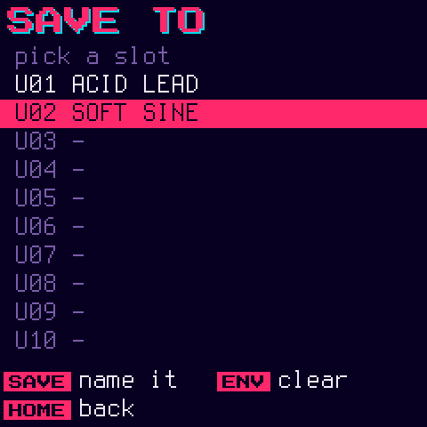
  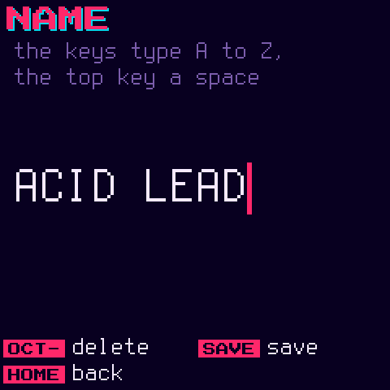
</p>

**SAVE** (on the main screen or in the editor) opens the save screen on the slot that's playing, or the first free one.
There are 64 slots. A slot keeps the whole patch: the formula, `a`-`h`, the loop, glide and the voice mode, with
DUAL's detune and offset or MULTI's right side.

| | |
| --- | --- |
| SELECT / PRESETS | pick a slot |
| SAVE | name it (next screen) |
| ENV, twice | clear the slot. The first press asks |
| HOME | back |

On the name screen the keys type A to Z (the top key is a space) and **OCT-** deletes. **SAVE** saves, **HOME** goes
back to the slots. Saved slots come after the built-ins on **PRESETS**.

## CC mapping

<p align="center">
  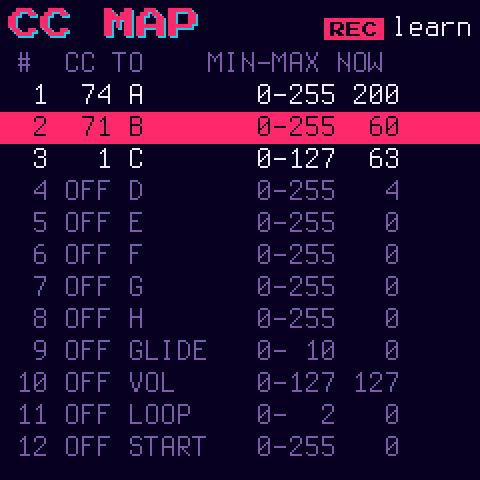
  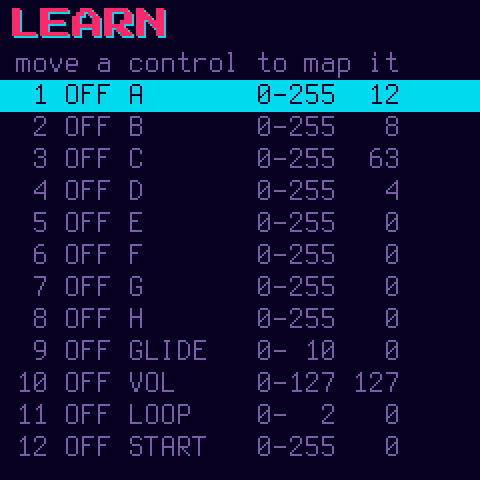
</p>

**GLO** opens the CC screen: 12 slots, each mapping a MIDI CC (on any channel) to a parameter over a min-max range.
Targets are `a`-`h`, glide, volume, the four loop settings, DUAL's detune and offset, width, and MULTI's right-side
variables (`RA`-`RH`). Setting min above max inverts the control. The NOW
column shows the parameter's value as it moves. Mappings are saved.

| | |
| --- | --- |
| SELECT | the slot |
| KNOB1 | its CC, or off |
| KNOB2 | its parameter (this resets the range to the parameter's whole range) |
| KNOB3 / KNOB4 | min / max |
| REC | learn: the next CC that comes in goes to the selected slot |
| GLO | back |

Empty slots already point at a target, so most of the time you only set the CC: slot 1 moves `a`, 2 `b` and so on to
8 `h`, then 9 glide, 10 volume, 11 the loop mode and 12 the loop start.

## Formula language

C expressions of `t` and the variables `a`-`h`, on 32-bit signed integers. The low 8 bits are the sample. Formulas
can be up to 90 characters (what fits on the main screen).

```
t  a..h  123  0x7F  ( )
?:  ||  &&  |  ^  &  == !=  < <= > >=  << >>  + -  * / %  unary - ~ !
```

Precedence is C's. Where C would be undefined, Bytemania defines it: overflow wraps, shifts use their count `& 31`,
and `x / 0` and `x % 0` are 0. Nothing has side effects, so `?:`, `&&` and `||` evaluate both sides.

## Building

You need Linux on x86-64 (or macOS / Windows with Docker or WSL), Python 3 with Pillow, the JieLi toolchain and the
JieLi AC79 SDK:

```sh
pip3 install Pillow mido python-rtmidi
tools/get_toolchain.sh
git clone --depth 1 --branch AC79NN_SDK_V1.2.1_2023-12-13 \
    https://gitee.com/Jieli-Tech/fw-AC79_AIoT_SDK.git ~/fw-AC79_AIoT_SDK
```

Set `JIELI_TOOLCHAIN` and `AC79_SDK` if they live elsewhere. Then:

```sh
./build.sh                                          # -> build/bytemania.fwsc
python3 tools/fm1_install.py build/bytemania.fwsc   # install over USB
```

Host mode runs the firmware on your computer, with no FM-1 needed:

```sh
tests/run_tests.sh       # unit tests: the formula compiler and the random formulas
tests/run_host.sh        # a demo: build/host/bytemania.wav and screenshots
tests/screenshots.py     # this README's screenshots, into docs/screens/
```

`tests/host.c` explains how to write your own host mode scripts (keys, buttons, knobs, MIDI and screenshots over time).

### Code layout

```
firmware/src/bytemania.c  <- the app: sound, screens, panel
firmware/src/bytebeat.c   <- the formula compiler and interpreter
firmware/src/formulas.h   <- the built-in patches
firmware/src/randbeat.c   <- the random formulas
firmware/src/platform.c   <- Dinghy's plumbing (boot, USB, updates, audio, settings, the user library in flash)
firmware/src/*.c, hal/    <- Felucca's platform, as SLOOP carries it
firmware/gen/             <- the fonts, generated
tools/gen_font.py         <- generates the pixel font from assets/fonts/
```

[docs/API.md](docs/API.md) covers what `platform.c` gives the app. [docs/RULES.md](docs/RULES.md) covers the chip's
rules (no floats, no 64-bit division, the audio interrupt's time budget) and what the build checks.

### Releases

Push a version tag (`git tag v0.1 && git push origin v0.1`). The release workflow builds `bytemania-<version>.fwsc`
with the hub's shared [fm1-build](https://github.com/zvenson/fm1-build) workflow, attests it and attaches it to the
release. Don't re-upload or rebuild the file by hand.

## Credits and licence

Bytemania is GPL-3.0-only. It's built on [Dinghy](https://github.com/zvenson/dinghy) (zvenson), which is built on
[Felucca](https://github.com/hugelton/Felucca) (Leo Kuroshita, Hügelton Instruments) and
[SLOOP](https://github.com/isod89/sloop-fm1) (isod89). The built-in bytebeats are credited above. The fonts are
Terminus and Press Start 2P, both under the SIL Open Font License. See [LICENSING.md](LICENSING.md) for who made what.

Bytemania is not made or endorsed by M-VAVE.
