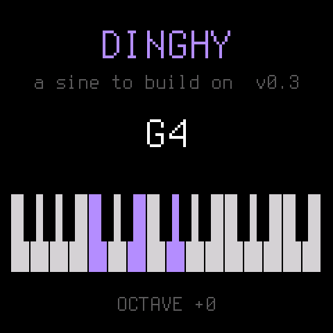

<p align="center"></p>

# Dinghy

**The smallest firmware for the M-VAVE FM-1 to build your own on.**

Dinghy plays a sine wave on the keys, and that is all it does. Under it is everything an FM-1 firmware needs
before it can be any fun: the update path, the USB rescue, USB-MIDI, USB audio, the keys, knobs and LEDs, the
screen and a place to keep settings. It all works, so you start with the part you actually want to write.

```
firmware/src/dinghy.c     <- your firmware: ~200 lines, a 4-voice sine. Start here.
firmware/src/platform.c   <- the plumbing (boot, USB, updates, audio ISR, settings). Done; read it, don't fight it.
firmware/src/*.c, hal/    <- Felucca's platform, as SLOOP carries it, unchanged
```

Dinghy is based on [Felucca](https://github.com/hugelton/Felucca) by Leo Kuroshita (Hügelton Instruments), with its
platform as [SLOOP](https://github.com/isod89/sloop-fm1) (isod89) carries it: it keeps that platform and throws away the
rest. The smallest boat of the family, after the felucca and the sloop.

<p align="center"></p>

> **Status: 0.3, runs on the FM-1.** Tested on the device: the install, MIDI in (pitch exact, 4 voices), USB audio
> at 44.1 / 48 kHz, the keys, the screen, the octave kept in flash, and back to another firmware through the hub.

## What you get

| | |
| --- | --- |
| **Updates that always work** | `tools/fm1_install.py`, the web installers and the [FM-1 Firmware Hub](https://fm1.designburgapps.com) reach your firmware over USB, so you (and your users) can always install the next build, or go back to the official firmware. |
| **USB rescue** | Hold **OCT-** while switching on: no sound, only the updater. If your firmware crashes twice at boot, the FM-1 goes there by itself. |
| **USB-MIDI** | In and out, class compliant: `midi_get()`, `midi_send()`. |
| **USB audio** | The FM-1 shows up as a 16-bit stereo audio input (44.1 or 48 kHz): record it into any DAW or phone. Nothing to do. |
| **Panel** | 27 keys, 14 buttons, 7 encoders, the MASTER knob, the LEDs, by name (`BTN_PLAY`, `ENC_KNOB1`, ...). |
| **Screen** | 240 x 240, text in two sizes, rectangles, lines, pixels. |
| **Settings** | `settings_load()` / `settings_save()`: up to 256 bytes with a CRC in their own flash sector. |
| **A crash screen** | A fault shows where it happened (the PC), then the FM-1 restarts. |
| **Host mode** | The same `dinghy.c` on your computer: the screen as an image, the sound as a WAV. No FM-1 needed to try an idea. |
| **Checks** | The build fails on what bricks or breaks an FM-1 firmware: a 64-bit division, a call into the chip ROM, too much RAM, a register touched outside `hal/`. |

## Build your own

From nothing to your own firmware on the FM-1, step by step. Each step works before you go to the next.

### 1. Copy it

On GitHub: **Use this template** (top right on this page) or fork it, then clone your copy. Rename nothing yet:
first make sure the unchanged Dinghy builds on your machine.

### 2. Set up once

You need Linux on x86-64 (or macOS / Windows with Docker or WSL), Python 3 with Pillow, the JieLi toolchain
and three files of the JieLi AC79 SDK:

```sh
pip3 install Pillow mido python-rtmidi
tools/get_toolchain.sh                      # JieLi's clang for the chip, to ~/.jieli/toolchain
git clone --depth 1 --branch AC79NN_SDK_V1.2.1_2023-12-13 \
    https://gitee.com/Jieli-Tech/fw-AC79_AIoT_SDK.git ~/fw-AC79_AIoT_SDK
```

On macOS the build runs the toolchain in a `linux/amd64` Docker container by itself (have Docker running).
`JIELI_TOOLCHAIN` and `AC79_SDK` point elsewhere if your copies live somewhere else.

### 3. Hear it without an FM-1

```sh
tests/run_host.sh                           # -> build/host/dinghy.wav and screen PNGs
```

Host mode runs the same `dinghy.c` on your computer: the sound as a WAV, the screen as images. Most ideas can be
tried here first, in seconds.

### 4. Your first change

Open [firmware/src/dinghy.c](firmware/src/dinghy.c) (~200 lines). The sound is `app_audio()`: it gets an empty
buffer of stereo frames and adds to it. Make the sine a square:

```c
s = ((int32_t)ph < 0 ? 8000 : -8000) * amp >> 15;     /* instead of s = (sine(ph) * amp) >> 15; */
```

Run `tests/run_host.sh` again and listen to `build/host/dinghy.wav`. The screen is drawn in `app_main()`, the keys
are read there too: change the text, add a knob ([docs/API.md](docs/API.md) has every call).

### 5. Onto the FM-1

```sh
./build.sh                                       # -> build/dinghy.fwsc (fails on what would brick the FM-1)
python3 tools/fm1_install.py build/dinghy.fwsc   # over USB; asks before it writes, restarts into your build
python3 tools/fm1_install.py --info              # what runs on the connected FM-1
```

That is the whole loop: change, hear it on the host, build, install. Back to another firmware, or to the official
one, with the [FM-1 Firmware Hub](https://fm1.designburgapps.com) in Chrome or Edge: Dinghy (and every copy of it)
answers the hub's updater like every firmware there. Installing firmware is at your own risk.

### 6. When it goes wrong

- **It crashes:** the screen shows where (the PC), then the FM-1 restarts. Twice at boot and it goes to the
  USB rescue by itself.
- **It won't start at all:** hold **OCT-** while switching on: the USB rescue, no sound, only the updater. Install
  a working build (or another firmware from the hub) from there.
- **The build refuses:** it checks for a 64-bit division, a call into the chip ROM, too much RAM, a register touched
  outside `hal/`. [docs/RULES.md](docs/RULES.md) says why each one matters; read it before your first crash.

### 7. Make it yours, release it, get into the hub

Your name and logo, your own package identity (so the FM-1 and the installers tell your firmware from Dinghy),
a GitHub release with the `.fwsc`, and how to get listed next to the others in the
[FM-1 Firmware Hub](https://fm1.designburgapps.com): **[docs/MAKE-IT-YOURS.md](docs/MAKE-IT-YOURS.md)**.

## Where to go next

- **[docs/API.md](docs/API.md)**: everything `platform.c` gives you, with the panel's ids, the screen calls, the
  audio contract, MIDI, settings, the flash map, timing.
- **[docs/MAKE-IT-YOURS.md](docs/MAKE-IT-YOURS.md)**: turn Dinghy into your firmware: the name, the package
  identity, releases, getting into the FM-1 Firmware Hub.
- **[docs/RULES.md](docs/RULES.md)**: the chip's rules (no FPU, no libgcc, the audio ISR's budget) and what the build
  checks for you. Read it before your first crash, not after.

## License

GPL-3.0-only, as Felucca and SLOOP: you may change and share it, and whoever gets your firmware gets its source.
Details, credits and third-party parts in [LICENSING.md](LICENSING.md).

The platform is Copyright (C) 2026 Leo Kuroshita (@kurogedelic), Hügelton Instruments, with SLOOP's changes (isod89).
Dinghy (the app, the host mode, the docs) by zvenson.
